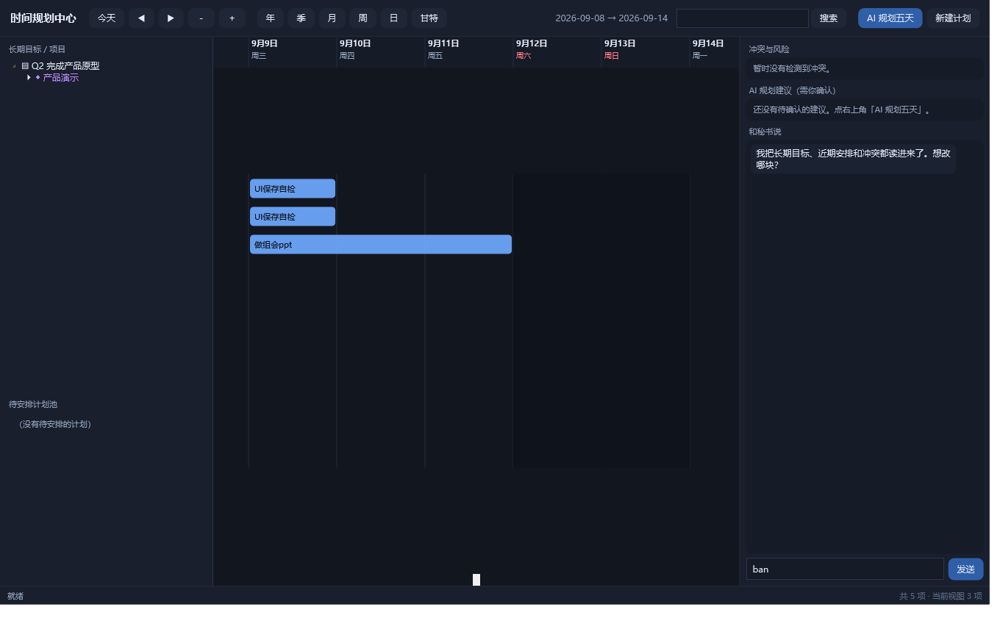
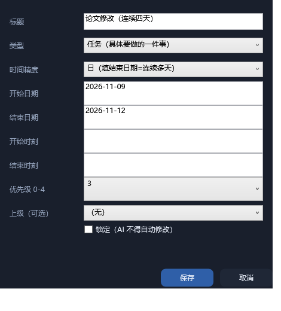

# 研途牛马秘书

> 给研究生的桌面 AI 秘书：**日程 / 提醒 / 桌宠 / AI 规划**，一个本地入口全搞定。

一个常驻桌面的二次元秘书角色，背后是一套本地运行的规划引擎：
DDL、组会、实验节点、论文计划都进同一个库；到点提醒你干活、喝水、休息；
改一处时间，提醒自动跟着变；AI 只给建议，**你点「执行」才动手**。

<p align="center">
  
</p>

<table>
<tr>
<td></td>
<td></td>
<td></td>
</tr>
<tr><td align="center">桌面待机</td><td align="center">到点提醒</td><td align="center">新建计划</td></tr>
</table>

---

## 为什么不是又一个待办 App

| 痛点 | 这里的做法 |
|---|---|
| 「下周把论文初稿给导师」——日历不肯收没有具体时刻的事 | **模糊时间**：年 / 季 / 月 / 周 / 日 / 具体时段 / 待安排，七级精度各自保真 |
| 计划一改，闹钟还按老时间响 | 提醒与计划**绑定**：改时刻原地更新，换日期自动撤销重建 |
| 一坐三小时，手机闹钟又太粗暴 | 桌宠用**角色动作 + 气泡**提醒喝水/休息，**全屏时自动静默** |
| 不想让 AI 乱改自己的安排 | AI 只产出**草稿建议**，必须确认才落库；**锁定的计划 AI 碰不到** |
| 数据想留在自己电脑里 | 本地 SQLite + 只监听 `127.0.0.1`；Key 仅本人可读，不进日志、不进导出 |

---

## 现在就能用的功能

| 模块 | 状态 | 说明 |
|---|---|---|
| **日程管理** | ✅ 可用 | 七级时间精度；目标 / 项目 / 阶段 / 里程碑 / 任务五类节点与父子关系；截止日、优先级、锁定、进度 |
| **时间规划中心** | ✅ 可用 | 三栏界面；年/季/月/周/日/甘特六种尺度；缩放平移、拖拽改期、冲突标记、待安排池、实时同步 |
| **未来五天滚动窗口** | ✅ 可用 | 默认 5 天 / 30 分钟粒度，可调 3 或 7 天；AI 按真实空档给安排建议 |
| **健康提醒** | ✅ 可用 | 喝水（120 分钟）、连续工作休息（50+10 分钟）、午晚饭点；免打扰时段、全屏静音、锁屏/休眠感知 |
| **桌宠** | ✅ 可用 | 透明置顶、分层骨骼动画（呼吸/摇摆/点头/眨眼/四套表情）、托盘、缩放、位置记忆、开机问候、专注模式 |
| **AI 秘书** | ✅ 可用 | 自然语言建/改/删计划、五天规划、冲突与风险分析、情景推演；模型优先、规则兜底 |
| **DSH 集成** | ✅ 可用 | 4 个 Agent 工具（`secretary_agenda` / `secretary_plan_item` / `secretary_findings` / `secretary_open`）；开机自动拉起引擎与桌宠 |
| **护眼 / 久坐提醒** | 🚧 计划中 | 复用现有健康调度器再加规则 |
| **番茄钟** | 🚧 计划中 | 桌宠专注计时可视化 |
| **指定文件管理** | 🚧 计划中 | 按目录/规则归档、检索、变更提醒 |
| **个人周报** | 🚧 计划中 | 从变更/完成/提醒记录聚合，模板可编辑 |

---

## 快速开始

```powershell
git clone git@github.com:huishao-hub/ds_secretary.git D:\AI-Secretary
cd D:\AI-Secretary

# 1) 配 Key（不配也能用，只是聊天走本地规则）
Copy-Item service\config.local.example.json service\config.local.json
notepad service\config.local.json

# 2) 起引擎 + 桌宠
powershell -NoProfile -ExecutionPolicy Bypass -File app\launch.ps1

# 3) 打开规划中心（或双击桌宠）
powershell -NoProfile -ExecutionPolicy Bypass -File app\PlanningCenter.ps1
```

环境：Windows 10/11、Node ≥ 22（用内置 `node:sqlite`，**零 npm 依赖**）、PowerShell 5.1。
DSH 用户：装 `plugin/` 这个 bundle 即可随 DSH 自动启动。

**出问题先自检**：

```powershell
powershell -NoProfile -ExecutionPolicy Bypass -File tools\selfcheck.ps1
```

15 项检查（Node / 引擎 / 数据库 / Key / 桌宠 / 插件 / 工具注册 / 备份），输出 `OK/WARN/FAIL` 与退出码。

---

## 架构

```
DSH Host ──► plugin/          拉起引擎与桌宠、注册 4 个 Agent 工具
                │
                ├─► service/   本地规划引擎（Node 24 + node:sqlite，40 条路由）
                │     · 模糊时间实体化、冲突检测、提醒调度、AI 适配
                │     · 只监听 127.0.0.1，随机端口 + 每次启动新 token
                │
                └─► app/
                      · Pet.ps1            透明置顶桌宠（分层动画 / 托盘 / 通知）
                      · PlanningCenter.ps1 三栏时间规划中心
data/secretary.db   计划 / 提醒 / 提案 / 变更历史
```

**AI 的边界**：模型只能输出 `create / update / delete + 目标 id`，
由服务端校验（id 必须真实存在、锁定项跳过），再以「草案」形式给你确认。
模型不能执行命令、不能绕过确认、不能改锁定项。

---

## 测试

```powershell
node tests\test-service.mjs                                  # 35 个端到端用例
powershell -File tests\smoke-rig.ps1                         # 角色骨架渲染冒烟
powershell -File tools\selfcheck.ps1                         # 运行态自检
```

35 个用例覆盖：模糊时间实体化、锁定保护（`409`）、提醒去重与重启补发、snooze、依赖成环拒绝、
proposal 确认机制、导入导出往返、AI 降级、开机邀请幂等等。

---

## 文档

| 文档 | 内容 |
|---|---|
| [使用手册](使用手册.md) | 每个按钮干什么、七种建计划填法、常见问题 |
| [类型与时间填法](docs/类型与时间填法.md) | 五种节点 × 七种精度的组合规则 |
| [API 契约](docs/API.md) | 本地服务 40 条接口与数据模型 |
| [角色管线](docs/CHARACTER.md) | 从一张立绘到分层骨骼的完整流程 |
| [测试记录](docs/TEST-RESULTS.md) | 13 项验收 + 资源实测 |
| [作品简介](docs/作品简介.md) | 面向场景与路线图 |

---

## 许可

- **代码**：MIT，见 [LICENSE](LICENSE)。
- **角色立绘与生成的图层资源**：见 [NOTICE.md](NOTICE.md)，随仓库仅用于本项目演示，
  如需复用请自行替换 `assets/character/source-850.png` 并用 `tools/` 下的脚本重新生成。
