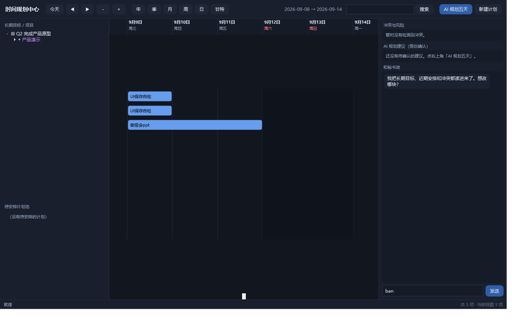
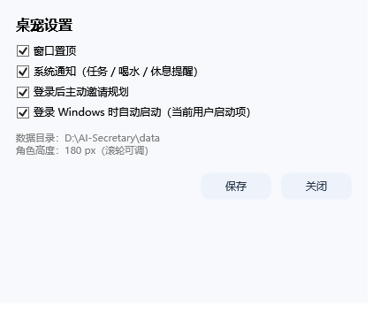

# AI 秘书 · 使用手册

> 写给"我不会用"的你。每一节都按 **「想做什么 → 点哪里 → 会发生什么」** 写。
> 文中所有行为都在你这台机器上实测过，没验证过的会标出来。

---

## 0. 先搞清楚有哪几个东西

| 东西 | 长得像 | 作用 |
|---|---|---|
| **桌宠** | 桌面右下角那个 180px 的小姑娘 | 日常入口：聊天、看计划、提醒你 |
| **规划中心** | 一个 1360×860 的大窗口 | 认真排计划的地方（时间轴） |
| **规划引擎** | 看不见（后台 node 进程） | 存数据、算冲突、发提醒 |
| **DSH 插件** | 看不见 | 开机时自动把上面三个拉起来，并让我（AI）能读写你的计划 |

**判断还活着没有**：右下角托盘里有个蓝色日历图标 = 桌宠在；规划中心窗口能打开 = 引擎在。

**全部重启（最省事的救命按钮）**：

```powershell
powershell -NoProfile -ExecutionPolicy Bypass -File "D:\AI-Secretary\app\launch.ps1"
```

---

## 1. 桌宠：鼠标怎么点她

| 操作 | 结果 |
|---|---|
| **单击** | 头顶弹出「要做什么？」面板（6 个按钮，见第 2 节） |
| **双击** | 直接打开**时间规划中心** |
| **右键** | 菜单：打开规划中心 / 和她说话 / 下一个任务 / 总在最前 / 免打扰 / 隐藏桌宠 / 专注 45 分钟 / 调整大小 / 设置 / 退出 |
| **按住左键拖动** | 移动她的位置，松手自动记住 |
| **滚轮** | 放大缩小角色（80–520 px） |
| **托盘图标双击** | 打开规划中心 |
| **托盘图标右键** | 显示/隐藏、和她说话、专注、免打扰、退出 |

> 单击面板 8 秒不点会自动收起；再点她一下也能收起。

---

## 2. 快捷面板的 6 个按钮

| 按钮 | 做什么 |
|---|---|
| **聊天** | 打开输入框，和她说话（见第 3 节） |
| **近期计划** | 打开规划中心 |
| **新建任务** | 她现在只会提示你："直接告诉我：明天下午两点到四点写项目方案" —— 也就是用聊天建。**这是 v1 的偷懒实现**，正经建计划请用规划中心的「新建计划」 |
| **规划五天** | 打开规划中心 |
| **下一个任务** | 她读数据库，告诉你下一件排了具体时间的事还有多久开始 |
| **专注模式** | 进入 45 分钟专注（见第 10 节） |

---

## 3. 和她聊天（也能让她建计划）

**打开**：快捷面板 → 聊天；或右键 → 和她说话。

**怎么用**：输入框打字，回车发送。她的回答显示在输入框**上方**那一行（"……"是正在想）。

**她能听懂的句子**（本地规则解析，实测覆盖）：

| 你说 | 她会 |
|---|---|
| `明天下午两点到四点写项目方案` | 建一条 14:00–16:00 的具体任务 + 两个提醒 |
| `2027 年我想系统地研究 AI` | 建**年度目标**（全年区间，不是某一天） |
| `2027 年第二季度完成产品原型` | 建**季度计划**（2027 Q2） |
| `下周三下午留给产品开发` | 建对应日期的安排 |
| `六月中旬完成测试` | 建成"六月中旬"这个**模糊窗口** |
| `把写项目方案推迟到下周` | 找已有任务改期 |
| `未来五天还有什么要安排` | 回答你五天内的情况 |
| `我的目标进展怎么样` | 拿真实进度回答 |

**她拿不准时会反问你**，不会自己编一个时间。比如你只说"下周弄一下那个事"，她会问你是哪件事、哪天。

> 没配 DeepSeek API Key 时，她用的是本地确定性规则 + 模板回复，语气比较直白；
> 配上 Key 才有自然润色和更自由的对话。Key 不是必须的，所有规划功能都照常工作。

---

## 4. 规划中心：先认路



```
┌──────────────────────────────────────────────────────────────────────┐
│ 顶栏：今天 ◀ ▶ － ＋ | 年 季 月 周 日 甘特 | 日期范围 搜索 | AI规划五天 新建计划 │
├───────────┬──────────────────────────────────┬───────────────────────┤
│ 左栏      │ 中栏：时间轴                      │ 右栏                  │
│ 长期目标树 │  - 顶部：日期刻度                 │ 冲突与风险            │
│ 待安排池   │  - 主体：计划色块 / 里程碑◆       │ AI 建议（接受/忽略）   │
│           │                                  │ 和秘书说（聊天）       │
├───────────┴──────────────────────────────────┴───────────────────────┤
│ 底部状态栏：操作结果 / 统计                                           │
└──────────────────────────────────────────────────────────────────────┘
```

### 顶栏按钮

| 按钮 | 作用 |
|---|---|
| **今天** | 回到今天/本周/本月 |
| **◀ ▶** | 往前/往后翻 |
| **－ ＋** | 缩小/放大时间轴（也可以用 `Ctrl+滚轮`） |
| **年 季 月 周 日 甘特** | 六种尺度。**周**是默认，正好覆盖未来五天 |
| **搜索框 + 搜索** | 按标题搜（实测 `方案` → 命中「写项目方案」） |
| **AI 规划五天** | 让引擎结合长期目标给建议（见第 7 节） |
| **新建计划** | 打开编辑框（见第 5 节） |

### 时间轴怎么操作

| 操作 | 结果 |
|---|---|
| 拖一个色块左右移动 | **改日期**（同一天内拖动不改时刻） |
| 右键色块 | 编辑… / 锁定 / 标记完成 / 删除…（删除会二次确认） |
| 双击左栏树节点 | 打开编辑框 |
| 双击"待安排计划池"里的条目 | 打开编辑框 |
| 竖向滚动 / 横向滚动 | 看更多 |

色块含义：**颜色 = 优先级**（0 灰蓝 → 4 红），**紫色菱形 = 里程碑**，**金边 = 已锁定**，半透明 = 已完成。

---

## 5. ★ 怎么建一条计划（最容易懵的地方）

点「新建计划」，会弹这个框：

| 字段 | 说明 |
|---|---|
| **标题** | 必填 |
| **类型** | 它是什么：`目标 / 项目 / 阶段 / 里程碑 / 任务` |
| **时间精度** | 它有多确定：`待安排 / 年 / 季 / 月 / 周 / 日 / 具体时段` ← **决定填哪些格** |
| 开始日期 / 结束日期 | `YYYY-MM-DD` |
| 开始时刻 / 结束时刻 | `HH:mm`，**只有"具体时段"才要** |
| 优先级 | 0–4 |
| 锁定 | 勾上后 AI 不能改，你自己还能改 |

### 照抄这七种情况

| 你想表达 | 类型 | 时间精度 | 具体怎么填 |
|---|---|---|---|
| 2027 全年重点学 AI | 目标 | **年** | 开始日期 `2027-01-01`，结束日期留空 |
| 2027 Q2 完成产品原型 | 项目 | **季** | 开始日期 `2027-04-01`，结束日期留空 |
| 六月做完测试 | 任务 | **月** | 开始日期 `2027-06-01` |
| 下周集中做某项目 | 任务 | **周** | 开始日期随便填下周一天 |
| 11 月 11 日产品演示 | 里程碑 | **日** | 开始日期 `2027-11-11` |
| 11-09 到 11-12 连做四天论文修改 | 任务 | **日** | 开始 `2026-11-09` + 结束 `2026-11-12`（**填了结束日期就是连续多天**） |
| 明天下午两点到四点写方案 | 任务 | **具体时段** | 日期 `2027-xx-xx` + 开始 `14:00` + 结束 `16:00`（两个时刻都要填） |
| 还没想好什么时候做 | 任务 | **待安排** | 日期时刻全留空 → 掉进左下"待安排计划池" |

### ★ 什么时候才会有提醒（重要）

只有**排到具体时刻**的东西才会到点提醒你：

| 你建的东西 | 会不会提醒 | 说明 |
|---|---|---|
| 具体时段（slot） | ✅ 开始 + 结束各一次 | 到 `开始时刻` 弹「开始：xxx」，到 `结束时刻` 弹「结束：xxx」 |
| 填了「截止日期」的任何计划 | ✅ 当天 09:00 一次 | 提醒你「今天到期」，前提是还没完成 |
| 日 / 周 / 月 / 季 / 年 | ❌ 不会 | 这些没有时刻，系统不知道几点叫你 |
| 待安排（unscheduled） | ❌ 不会 | 连哪天都没定 |
| 喝水 / 休息 / 饭点 | ✅ 系统自己生成 | 见第 12 节 |
| 点了「稍后提醒」 | ✅ 30 分钟后一次 | 生成一条新提醒 |

> 所以：**如果你想让某件事「到点叫你」，必须选「具体时段」并把开始/结束时刻填上。**
> 只填日期的话，它只会安静地躺在时间轴上，不会响。

### 系统会替你补的（已实测）

只填**开始日期**时，引擎会自动补全整段区间，并在数据库里标记精度：

```
年：2028-03-05 → 2028-01-01 ~ 2028-12-31   （标签「2028 年」）
季：2028-08-20 → 2028-07-01 ~ 2028-09-30   （标签「2028 Q3」）
月：2028-02-10 → 2028-02-01 ~ 2028-02-29
周：2028-02-10 → 2028-02-07 ~ 2028-02-13   （周一到周日）
日：2028-02-10 → 2028-02-10
```

**"具体时段"漏填时刻会被拒绝**，提示：`slot precision requires startTime and endTime`。

> 为什么区分"年"和"具体时段"？因为二者在库里是**不同精度**，不是同一个日期字段的两种写法。
> 年度目标不会被偷偷当成某一天的某个时刻；等你真的想细化，再新建一条更细的子任务。

---

## 6. 改计划

| 想改 | 怎么做 |
|---|---|
| 改日期 | 时间轴上直接拖色块 |
| 改时刻/标题/优先级/锁定 | 右键色块 → 编辑… |
| 标记完成 | 右键色块 → 标记完成（进度变 100%） |
| 删除 | 右键色块 → 删除… → 确认 |
| 把待安排的计划排进日历 | 双击左栏"待安排计划池"里的条目 → 填上日期时刻 |

**改完时间，提醒会自动跟着改**（同一天内改时刻、跨天改日期都已修好并实测）。
锁定(🔒)只拦 AI，不拦你自己。

---

## 7. AI 建议怎么用

1. 点顶栏 **AI 规划五天**。
2. 右栏「AI 规划建议」出现一张卡片，写着它想怎么排（带真实数字，比如"待安排池有 1 项，按截止近的优先排了 1 项"）。
3. 点 **接受** → 写进计划；点 **忽略** → 丢掉。

**在你点"接受"之前，它一个字都不会写进你的计划**。锁定的计划在应用时会被跳过，并在结果里告诉你跳过了几条。

---

## 8. 冲突与风险怎么看

右栏最上面那块，六类：

| 类型 | 意思 |
|---|---|
| 时间冲突 | 两个具体时段撞了（会写清重叠多少分钟） |
| 截止风险 | 快到 due 了但进度还很低 |
| 依赖冲突 | 前置没做完、后面已经排上了 |
| 负荷过高 | 某天排太满 |
| 目标停滞 | 长期目标 30 天没进展 |
| 缺少执行 | 季度/月计划下面一个子任务都没有 |

有冲突时，开机问候也会提一句（"今天有 1 处安排冲突"）。

---

## 9. 提醒来了怎么处理

到点时她切 REMINDING 状态、弹气泡、同时发**系统通知**（进 Windows 操作中心），面板上是：


| 按钮 | 实际效果（实测） |
|---|---|
| **开始** | 这条提醒标记"已确认"；**任务状态不变**，结束提醒照常会来 |
| **完成** | 任务进度置 100%、状态改 done，并**撤销它剩下的所有提醒** |
| **推迟 30 分钟** | 生成一条 30 分钟后的**新提醒**，原提醒归档 |
| **跳过** | 只停这一次，不建新提醒 |
| **查看计划** | 打开规划中心 |

**免打扰时不会丢提醒**：如果当时在前台全屏（游戏/视频）或开着免打扰，她**不去取**提醒队列，
提醒留在服务端，解除后照常弹。

---

## 10. 专注模式

右键 → 专注 45 分钟（或快捷面板 → 专注模式）。
期间她的动作幅度会变小、更安静；45 分钟后自动提醒你休息，并恢复常态。
托盘图标文字会变成「专注中」。想提前结束：再点一次菜单里的专注（会重新计时）或重启桌宠。

---

## 11. 设置

右键 → **设置**：



| 选项 | 说明 |
|---|---|
| 窗口置顶 | 关掉后她会被其他窗口盖住 |
| 系统通知 | 任务/喝水/休息提醒是否发 Windows 通知 |
| 登录后主动邀请规划 | 开机问候的总开关 |
| 登录 Windows 时自动启动 | **默认关闭**。勾选并保存才会写进当前用户的启动项（`HKCU\...\Run`）——这一步需要你明确同意 |

角色大小也可以直接滚轮调，会存进 `data\pet-settings.json`。

---

## 12. 喝水 / 休息 / 饭点（原有功能，保留）

| 提醒 | 规则 |
|---|---|
| 喝水 | 每 **120 分钟**一次 |
| 休息 | 连续工作 **50 分钟** → 提醒休息 **10 分钟**，休息结束后重新计时 |
| 午饭 / 晚饭 | 每天 **11:00 / 18:00**，有 45 分钟补提醒窗口，当天只提醒一次 |

这些和你自己排的任务提醒走同一条通道（都会弹面板 + 系统通知），免打扰时同样延后不丢。

> 注意：这几个是**时间累计型**提醒，第一杯水要等 120 分钟、第一次休息要等 50 分钟才会到。
> 我这一轮没法当场等到点，需要你实际工作一段时间确认（这一点在测试记录里如实标了"待人工验证"）。

---

## 13. 数据在哪、怎么备份

| 东西 | 位置 |
|---|---|
| 所有计划/提醒/历史 | `D:\AI-Secretary\data\secretary.db`（SQLite） |
| 桌宠位置/大小/开关 | `D:\AI-Secretary\data\pet-settings.json` |
| 引擎连接信息（端口+令牌） | `D:\AI-Secretary\data\bridge.json` |
| 日志 | `D:\AI-Secretary\logs\`（`pet.log` / `planner.log` / `service.log`） |

**备份**：复制整个 `D:\AI-Secretary\data` 文件夹即可。
也可以调 `GET /export` 导出一份 JSON（不含密钥）。

**清空那 6 条演示数据**：在规划中心右键 → 删除（逐条），或者告诉我，我帮你清。

---

## 14. 常见问题

**她不见了？**
双击托盘图标，或托盘右键 → 显示/隐藏。如果托盘图标也没了，跑一次 `launch.ps1`。

**她说"连不上规划服务"？**
引擎没起。跑 `launch.ps1`（会先起引擎再起桌宠，等约 5 秒）。

**规划中心打不开了 / 之前崩过？**
先看 `logs\planner.log` 最后几行。现在加了护栏：单个按钮出错只会底部提示「出错了（已写日志）」，窗口不会整个消失。
如果进程真的没了，重新双击桌宠即可。

**AI 说话很机械？**
引擎没读到 Key 时会走本地规则。Key 放在 `service\config.local.json`（`{"apiKey":"sk-..."}`，已帮你填好并限制为仅当前用户可读）。
改完要重启引擎才生效：跑一次 `launch.ps1` 或重启 DSH。

**拖了计划，提醒还是旧时间？**
这个 bug 我已经修了（同一天改时刻、跨天改日期都会同步）。如果你还遇到，把 `logs\service.log` 发我。

**目标怎么删？**
左栏「长期目标 / 项目」里**右键那个目标 → 删除…**（时间轴上只画 5 天，2027 年的目标不在上面，所以必须从树上删）。
待安排池里的条目同理，右键删除。
也可以直接对她说：「删除 2027 年系统研究 AI」或「全部删除」，她会弹一张确认卡片，点「执行」才真的删。

**她只会说、不会做？**
现在会做了：你一句话先被解析成「新建/修改/删除」操作，弹一张卡片列清楚要改什么，点「执行」才写入。
解析不出来时她才用模型聊天，所以不会再出现"说了三遍全部删除她还在问"。

**删了/改了，界面什么时候变？**
你自己在窗口里删改：**立刻**（先本地生效，再跟服务端对齐，底部会显示「已删除 xxx」）。
在别处改的（桌宠聊天建的、AI 工具建的）：窗口每 3 秒自动同步一次，最多 3 秒自己出现/消失。
以前只有 60 秒一次，且同时开多个窗口会互相看不到对方的改动 —— 已修，并且现在只允许开一个窗口。

**改了系统时区会怎样？**
v1 固定按东八区墙上时间处理，没做跨时区换算。

---

## 15. 一页速查

```
打开规划中心    双击桌宠 / 托盘双击 / 右键→打开规划中心
和她说话        单击→聊天 / 右键→和她说话
建计划          规划中心 → 新建计划（先选"时间精度"，见第 5 节表格）
拖改日期        时间轴上拖色块
改/锁/删        右键色块
看 AI 建议      顶栏「AI 规划五天」→ 右栏卡片 → 接受/忽略
看冲突          右栏「冲突与风险」
调大小          滚轮 / 右键→调整大小
安静一会        右键→免打扰
专注            右键→专注 45 分钟
全部重启        powershell -File "D:\AI-Secretary\app\launch.ps1"
看日志          D:\AI-Secretary\logs\*.log
```
